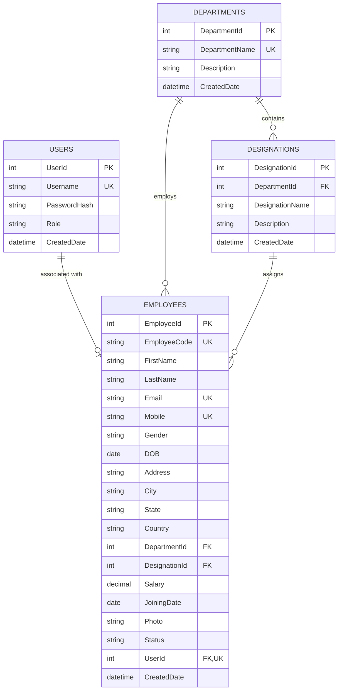

# Entity-Relationship (ER) Diagram

This document contains the Entity-Relationship (ER) Diagram for the **Employee Management System** using Mermaid notation.

## Entity Descriptions

1. **USERS**: Stores authentication credentials, hashed passwords (BCrypt), and role-based permissions (`Admin`, `Employee`).
2. **DEPARTMENTS**: Defines organizational departments (e.g., Information Technology, HR, Finance) with unique name constraints.
3. **DESIGNATIONS**: Defines job titles linked to specific departments (e.g., Senior Software Engineer in IT).
4. **EMPLOYEES**: Primary operational entity containing employee biographical data, contact info, salary, status, department/designation foreign keys, and optionally linked user login credentials.
