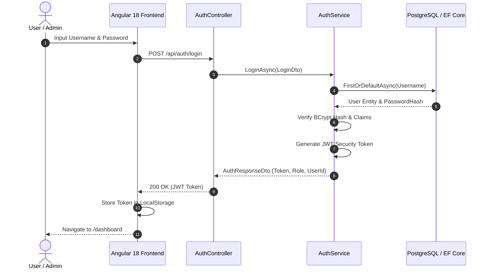
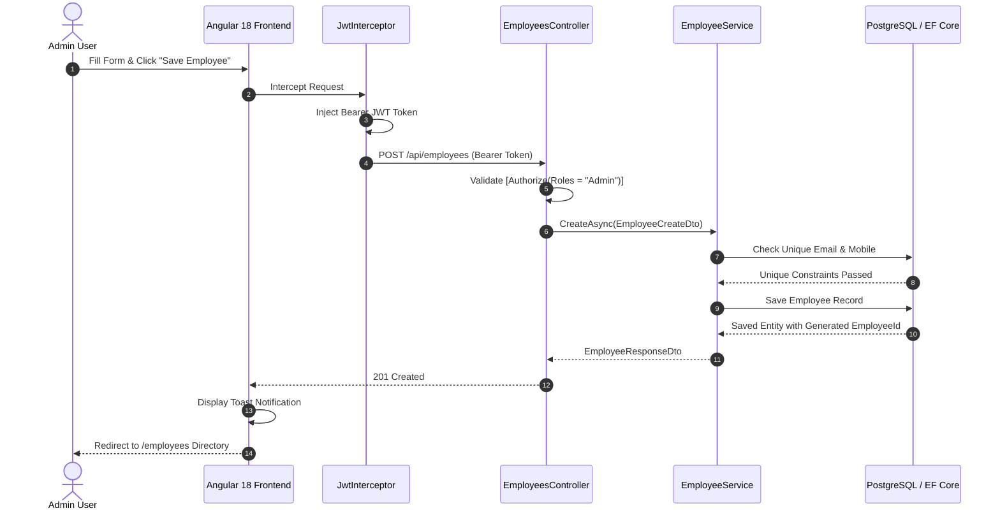

# Sequence Diagram

This document illustrates the sequence of operations during JWT Authentication and Employee Creation.

## Sequence 1: JWT Authentication & Login Flow

## Sequence 2: Employee Creation Flow (Admin)

