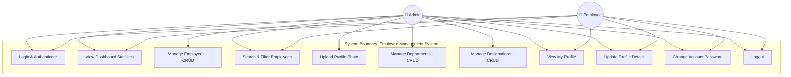

# Use Case Diagram

This document illustrates the actor interactions and system use cases for the **Employee Management System**.

## Actor Summary

- **Admin**: Has full administrative privileges across all modules including department management, designation mapping, employee creation/editing/deletion, and overall system reporting.
- **Employee**: Authenticated user with restricted access to view executive dashboard metrics, search/filter directory records, manage personal profile details, and update security password.
